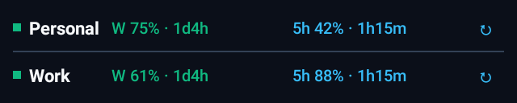
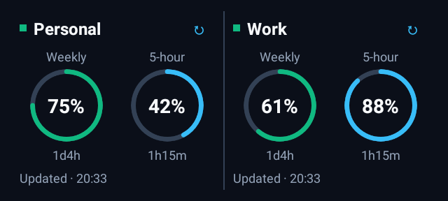

# Codex Quota Monitor for Android — Two-Account Widgets

An Android app for checking Codex quota across accounts without repeatedly opening the usage page. This fork focuses on **two accounts**, compact home-screen widgets, and keeping the last valid reading visible when a refresh fails.

Based on [boudywho/codex-quota-android](https://github.com/boudywho/codex-quota-android), under the [MIT license](LICENSE). This is an independent community project and is not affiliated with OpenAI.

## What it does

- Shows server-reported **weekly** and **5-hour** remaining quota, with separate reset countdowns.
- Provides a **4×1 compact widget** and a **4×2 gauge widget** for two selected accounts.
- Lets each widget use custom account names and swap account order.
- Keeps successful readings during connection errors and expired sessions, alongside their original update time and an appropriate status.
- Supports widget refresh actions, background sync, and the upstream account dashboard, alerts, themes, and single-account widgets.

Percentages represent remaining quota in each usage window. They are not raw token counts.

## Widget layouts

### 4×1: two compact rows

Each row contains the account name, weekly remaining percentage and reset countdown, 5-hour remaining percentage and reset countdown, and refresh control.



### 4×2: two account panels

Each panel shows one account, with separate weekly and 5-hour rings, reset countdowns, and sync status.



These are native Android widget renders using fictional **Personal** and **Work** accounts. Launcher grid dimensions vary: the layout switches automatically at an actual content height of 108dp. Resizing below that height selects the compact layout.

## Reliability changes

This fork addresses refresh failures that could replace valid quota with misleading 0% or 100% readings, or leave widgets showing an old state without a useful explanation:

- Preserves both quota windows, reset times, and the successful fetch timestamp after a failed refresh.
- Treats missing or invalid quota as unknown instead of inventing a percentage.
- Keeps quota errors separate from optional subscription-details errors.
- Observes database and preference changes and requests widget updates after app refreshes and account edits.
- Saves account selection per widget so reordering accounts does not silently change the selected account.
- Serializes refreshes for the same account, applies HTTP timeouts, and retries transient background failures.
- Fixes the medium widget's progress bar to reflect the remaining percentage.

See the [implementation notes and phone verification checklist](docs/widget-reliability.md).

## Install and use

Download `codex-quota-widget-fix-2.apk` from [this fork's test release](https://github.com/Bingxi-Jiang/codex-quota-android-widgets/releases/tag/widget-fix.2), or build it using the steps below. The release also includes `SHA256SUMS.txt` for verifying the download. Access to this private repository requires a GitHub account with permission to view it. The upstream project's release APK does **not** include these changes.

The current debug build is **Codex Quota Test**, version **1.2.0-widget-fix.2** (version code 21), package `com.codex.quota.debug`. It installs alongside the upstream app. Accounts and widget configuration are separate between the two apps. Updating an existing test installation requires an APK signed with the same debug key.

1. Install the test APK on Android 8.0 or later and sign in through the app's account flow.
2. Add your two accounts and choose their names.
3. Add the multi-account widget from your launcher's widget picker.
4. Select the two accounts, optionally set widget-specific aliases, and save.
5. Resize to approximately 4×1 for rows or 4×2 for rings. Tap refresh to request a new reading.

## Refresh behavior and limits

New installations default to a 15-minute background sync interval. Existing preferences, including disabled background sync, are respected. Android WorkManager has a 15-minute minimum periodic interval; Doze, battery restrictions, network availability, and manufacturer scheduling can delay execution. This is **not second-by-second monitoring**.

Check the last successful sync time. A cached reset countdown reaching zero does not prove the server has restored quota; the widget shows `due` until another valid reading arrives. If authentication expires, cached quota remains visible with a sign-in status, and signing in again is required. Automatic OAuth token renewal is not implemented in this fork.

Subscriber readings use the upstream app's unofficial ChatGPT usage endpoint. Its availability and response format can change. Compare values with the official usage display at approximately the same time when testing on a phone.

## Build from source

Requirements: **JDK 17 or 21**, Android SDK **Platform 35**, and Android SDK build tools. The Gradle wrapper downloads Gradle 8.11.1; Android Gradle Plugin 8.7.3 uses Build Tools 34.0.0 by default. Android Studio can install the required SDK packages.

Clone this repository using its GitHub **Code** button, then open the project directory. Point `ANDROID_HOME` to your SDK, or set `sdk.dir` in an untracked `local.properties` file.

Windows PowerShell:

```powershell
.\gradlew.bat testDebugUnitTest lintDebug assembleDebug
```

macOS / Linux:

```sh
chmod +x gradlew
./gradlew testDebugUnitTest lintDebug assembleDebug
```

The APK is written to `app/build/outputs/apk/debug/app-debug.apk`. No release signing credentials are needed for a debug build.

To keep SDK files, caches, temporary files, and the debug key on a specific drive, configure paths **before the first build**. For example, on Windows:

```powershell
$env:JAVA_HOME = 'D:\AndroidTools\jdk-17' # Your installed JDK
$env:ANDROID_HOME = 'D:\AndroidTools\sdk'
$env:GRADLE_USER_HOME = 'D:\AndroidTools\gradle-cache'
$env:ANDROID_USER_HOME = 'D:\AndroidTools\android-user'
$env:TEMP = 'D:\AndroidTools\temp'
$env:TMP = $env:TEMP
New-Item -ItemType Directory -Force -Path $env:ANDROID_USER_HOME, $env:TEMP | Out-Null
.\gradlew.bat testDebugUnitTest lintDebug assembleDebug
```

Install the JDK and SDK at the selected paths first. Keep the generated debug keystore if you want subsequent APKs to update an existing installation. Never commit signing keys, account data, or tokens. Release signing uses external credentials as described in the Gradle configuration; the inherited release workflow requires repository signing secrets.

GitHub Actions runs tests, lint, and a debug build on pushes to `main` and pull requests. CI APK attachment upload is optional: set the repository Actions variable `UPLOAD_CI_APK` to `true` to enable it when artifact storage is available. Test APK downloads are available from the release linked above.

## Validation

The current test build passed:

| Check | Result |
| --- | --- |
| JVM / Robolectric tests | 78 passed; no failures or skips |
| Native widget layout checks | 8 sizes, from 280×48dp to 360×160dp; no detected text clipping |
| Android lint | 0 errors; 83 warnings |
| Debug APK | Built and signature verified |

The rendering tests inflate actual Glance RemoteViews with Robolectric API 34 native graphics. They write preview PNGs to `../outputs/widget-previews/`, relative to the repository root. Tests cover cache retention, errors, account selection and aliases, missing data, ring rendering, and text bounds.

**Live account accuracy and physical phone behavior still require testing.** Previews and automated checks do not establish how every launcher or battery policy behaves.

## Project structure

| Path | Purpose |
| --- | --- |
| `app/src/main/java/com/codex/quota/data/` | Remote usage requests, local persistence, and account repository |
| `app/src/main/java/com/codex/quota/widget/` | Glance widgets, configuration, layout models, and ring drawing |
| `app/src/main/java/com/codex/quota/worker/` | Background refresh and scheduling |
| `app/src/test/` | Unit, repository, state, and native rendering tests |
| `docs/widget-reliability.md` | Detailed changes and device testing checklist |

Built with Kotlin, Jetpack Compose, Glance, Room, DataStore, and WorkManager.

## Attribution and license

The original app, dashboard, authentication flows, and project foundation come from [boudywho/codex-quota-android](https://github.com/boudywho/codex-quota-android). This work starts from upstream commit `11315161acdc8839972dbaeb0c910a0afdd36d9f` and adds the widget and refresh changes described above. The original copyright notice is retained in [LICENSE](LICENSE).
